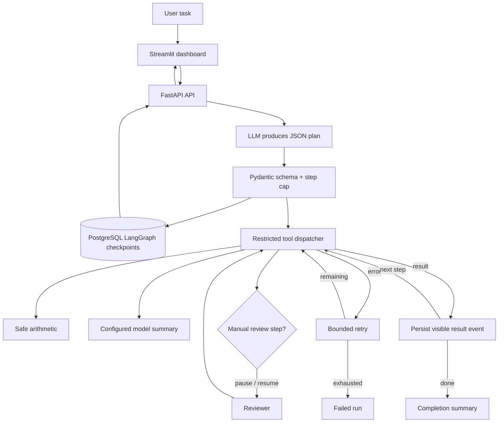

# Reasoning-Model Dynamic Planner with Extended Thinking Loops

A task planner with a bounded, schema-validated plan/execute/recover loop, durable LangGraph checkpoints in PostgreSQL, a FastAPI API, and a Streamlit dashboard. A configured OpenAI-compatible chat-completions endpoint supplies plans and summaries; no model is trained or hosted by this repository.

“Thinking loop” here means a visible sequence of task steps, tool results, human approvals, and recovery events. The system does not request, persist, or display hidden chain-of-thought. Use the execution trace to audit what the application actually did.

## Architecture and flow



## Included workflow

- `POST /runs` accepts a task, validates its length, creates a thread ID, and invokes the graph.
- The model proposes JSON with at most `MAX_STEPS` steps. Each step has a bounded description/input and one of three tools: `calculate`, `summarize`, or `manual_review`.
- The calculator parses arithmetic through a restricted AST evaluator; it cannot execute Python code.
- The summary tool sends only its explicitly supplied text to the configured model endpoint.
- Manual review pauses the graph. The dashboard can submit approve/reject through `POST /runs/{thread_id}/approval`.
- Tool errors get a bounded retry count, then the run becomes failed.
- `GET /runs/{thread_id}` returns plan, status, approval request, and execution events.

## Quick start

Requires Python 3.11+, PostgreSQL, and an OpenAI-compatible model endpoint with chat completions and JSON response formatting support.

```sh
python -m venv .venv
source .venv/bin/activate
pip install -r requirements.txt
cp .env.example .env
```

Set `DATABASE_URL`, `MODEL_BASE_URL`, `MODEL_API_KEY`, `MODEL_NAME`, and optional limits in `.env`. The model credentials must be handled as secrets and `.env` must remain untracked. Prepare a PostgreSQL database and start the API and dashboard in separate terminals, loading `.env` into each shell:

```sh
set -a; source .env; set +a
uvicorn app.main:app --host 127.0.0.1 --port 8000
```

```sh
set -a; source .env; set +a
streamlit run app/ui.py
```

Open the Streamlit URL shown by the command. The API liveness check is `GET /health`.

## Limits and production notes

- The model endpoint is configurable; the listed example model families in the project request are not bundled and are not guaranteed to implement this endpoint’s JSON mode.
- Runs currently execute within the API process. For long workloads, deploy a worker queue and a separate run scheduler before exposing this service broadly.
- Protect API routes with your organization’s authentication and authorization layer before multi-user deployment. Thread IDs alone are not authorization.
- Configure TLS, request limits, provider timeouts/rate limits, checkpoint retention, and PostgreSQL backups for deployed use.
- The run API has no test suite or CI workflow yet.

See [development guide](docs/DEVELOPMENT.md), [architecture and operations](docs/ARCHITECTURE.md), and [deployment guide](docs/DEPLOYMENT.md).
